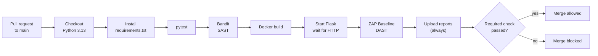
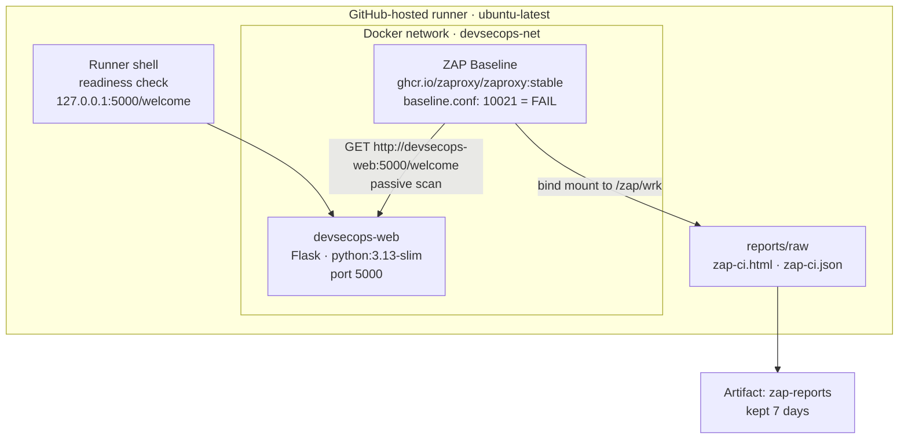
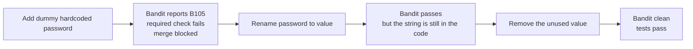

# DevSecOps Lab Walkthrough

A guided tour of the lab: how a small Flask app grew into a CI pipeline with a SAST scan, a DAST scan and a merge gate, and what each experiment proved.

> An interactive version (click through the pipeline stages) is available on [GitHub Pages](https://zsunnn.github.io/devsecops-security-pipeline-lab/). The [README](README.md) has the commands to run everything locally.

| | |
|---|---|
| **Application** | A minimal Flask app with `/` and `/welcome`, three pytest tests |
| **CI** | GitHub Actions, 11 workflow steps, runs on pull requests to `main` and pushes to `main` |
| **SAST** | Bandit (`bandit app.py`) |
| **DAST** | OWASP ZAP Baseline against the app running in Docker |
| **Gate** | Required status check blocks merging; ZAP rule 10021 is set to `FAIL` |
| **Period** | 11 – 26 September 2026 · 7 merged pull requests |

## Contents

1. [The pipeline](#1-the-pipeline)
2. [Where the scan runs](#2-where-the-scan-runs)
3. [Build timeline](#3-build-timeline)
4. [Experiments](#4-experiments)
5. [What ZAP still reports](#5-what-zap-still-reports)
6. [Run it locally](#6-run-it-locally)
7. [Limitations](#7-limitations)

---

## 1. The pipeline

Every pull request to `main` goes through the same steps. A failure at any step turns the required check red and GitHub blocks the merge.



| Step | What it does | Fails when |
|---|---|---|
| Trigger | Runs on `pull_request` to `main` and on `push` to `main`; token permission is `contents: read` | n/a |
| Checkout and Python | `actions/checkout` with `persist-credentials: false`, then Python 3.13 | Setup cannot complete |
| Install | `python -m pip install -r requirements.txt` (pinned versions) | A dependency cannot be installed |
| pytest | Three route and header tests | Any test fails |
| Bandit | Static analysis of `app.py` | Bandit reports an issue (for example B105) |
| Docker build | Builds `devsecops-lab:ci` from `python:3.13-slim` | The image does not build |
| Start and wait | Starts Flask on `devsecops-net`, then calls `/welcome` up to 15 times, 2 seconds apart | No HTTP response; the container logs are printed and the step fails |
| ZAP Baseline | Scans `http://devsecops-web:5000/welcome` with `baseline.conf` and `-I` | A finding configured as `FAIL` (exit code 1) |
| Upload reports | Uploads `zap-ci.html` and `zap-ci.json` even after earlier failures, kept for 7 days | No report file exists (`if-no-files-found: error`) |

The `-I` option stops `WARN` findings from failing the scan. Findings listed as `FAIL` in `.zap/baseline.conf` still fail it.

---

## 2. Where the scan runs

Flask and ZAP are two containers on one Docker network, so ZAP reaches the app by container name.



---

## 3. Build timeline

| When | Milestone | Pull request | What changed |
|---|---|---|---|
| 11 – 12 Sep | Git and GitHub basics | [#1](https://github.com/zSunnn/devsecops-security-pipeline-lab/pull/1) | Repository initialised, branches and a first pull request, learning notes |
| 12 Sep | First web app and CI | [#2](https://github.com/zSunnn/devsecops-security-pipeline-lab/pull/2) | Flask app with route tests; GitHub Actions runs pytest on pull requests |
| 14 – 16 Sep | SAST | [#3](https://github.com/zSunnn/devsecops-security-pipeline-lab/pull/3) | Bandit added to CI; gate tested with a dummy hardcoded value |
| 18 – 26 Sep | Docker and DAST | [#4](https://github.com/zSunnn/devsecops-security-pipeline-lab/pull/4) | Dockerfile, container start in CI, readiness check, ZAP Baseline with reports, `nosniff` fix |
| 26 Sep | DAST gate verification | [#5](https://github.com/zSunnn/devsecops-security-pipeline-lab/pull/5) (experiment), [#6](https://github.com/zSunnn/devsecops-security-pipeline-lab/pull/6) (notes) | CSP finding temporarily set to `FAIL`, then reverted |
| 26 Sep | Documentation | [#7](https://github.com/zSunnn/devsecops-security-pipeline-lab/pull/7), [#8](https://github.com/zSunnn/devsecops-security-pipeline-lab/pull/8) | README with local run steps; interactive lab overview |

Pull request #5 was the experiment and was not merged.

---

## 4. Experiments

Each experiment changes one thing, observes the result and records what it does and does not prove.

### A · SAST gate: does Bandit block a hardcoded password?



| Commit | Change | Result |
|---|---|---|
| `d380ee6` | Add Bandit to CI | Scan passes |
| `29adbcc` | Add a dummy hardcoded password | B105 reported, merge blocked |
| `3b4148a` | Rename `password` to `value` | Scan passes, but the hardcoded string is still there |
| `7a2e4e9` | Remove the unused dummy value | No issues, both tests pass |

**Lesson:** a passing SAST check does not prove the code is secure. A reviewer still has to check whether the underlying problem was fixed. Only synthetic data was used. Notes: [docs/sast-lab.md](docs/sast-lab.md).

### B · DAST finding: a missing header, fixed

ZAP rule **10021** (X-Content-Type-Options header missing) was reported on `/` and `/welcome`. The fix is one hook in `app.py`:

```python
@app.after_request
def add_security_headers(response):
    response.headers["X-Content-Type-Options"] = "nosniff"
    return response
```

A test pins the behaviour so it cannot regress silently:

```python
def test_welcome_has_nosniff_header():
    client = app.test_client()
    response = client.get("/welcome")
    assert response.headers.get("X-Content-Type-Options") == "nosniff"
```

Evidence: all three tests passed, `curl` showed the header, and the follow-up ZAP report no longer contained 10021. Rule 10021 stays configured as `FAIL` in `.zap/baseline.conf`.

### C · DAST gate: can a ZAP finding block a merge?

The existing CSP finding (rule **10038**) was temporarily configured as `FAIL` in pull request [#5](https://github.com/zSunnn/devsecops-security-pipeline-lab/pull/5).

| Observation | Result |
|---|---|
| ZAP | Reported 10038 as `FAIL` and exited with code 1 |
| Required check | Failed; GitHub blocked the merge |
| Reports | HTML and JSON were still uploaded |
| After the revert | CI passed again |

**What it proves:** a ZAP finding configured as `FAIL` can block a merge.
**What it does not prove:** it did not fix the missing CSP header, and it did not test a regression of rule 10021. Notes: [docs/dast-lab.md](docs/dast-lab.md).

---

## 5. What ZAP still reports

From the ZAP 2.17.0 report of a CI run on 25 September 2026 (`zap-ci.json`, target `http://devsecops-web:5000`). Rule 10021 is not in the list, which matches the `nosniff` fix.

| Alert | Rule | Risk (confidence) | Instances |
|---|---|---|---|
| Content Security Policy (CSP) Header Not Set | 10038 | Medium (High) | 4 |
| Missing Anti-clickjacking Header | 10020 | Medium (Medium) | 2 |
| Cross-Origin-Embedder-Policy Header Missing or Invalid | 90004 | Low (Medium) | 2 |
| Cross-Origin-Opener-Policy Header Missing or Invalid | 90004 | Low (Medium) | 2 |
| Cross-Origin-Resource-Policy Header Missing or Invalid | 90004 | Low (Medium) | 2 |
| Permissions Policy Header Not Set | 10063 | Low (Medium) | 4 |
| Server Leaks Version Information via "Server" HTTP Response Header Field | 10036 | Low (High) | 4 |
| Storable and Cacheable Content | 10049 | Informational (Medium) | 4 |

Only rule 10021 is gated. The rest are warnings that do not fail the scan, and they remain unresolved. The CI artifact expires after 7 days; this report was downloaded and kept locally.

---

## 6. Run it locally

Windows PowerShell, from the repository root. Needs Git, Python 3.13 and Docker Desktop with Linux containers.

```powershell
# checks
py -3.13 -m venv .venv
.\.venv\Scripts\python.exe -m pip install -r requirements.txt
.\.venv\Scripts\python.exe -m pytest -q
.\.venv\Scripts\python.exe -m bandit app.py

# build and start the app
docker build -t devsecops-lab:local .
docker network create devsecops-net
docker run --rm --name devsecops-web --network devsecops-net -p 127.0.0.1:5000:5000 devsecops-lab:local
```

In a second terminal, `curl.exe -i http://127.0.0.1:5000/welcome` should return HTTP 200 with `X-Content-Type-Options: nosniff`. The ZAP command and the report paths are in the [README](README.md#run-zap-baseline).

---

## 7. Limitations

- The app uses Flask's development server; it is a lab, not a production deployment.
- ZAP Baseline crawls and scans passively. It is not a full active assessment.
- CSP and other reported warnings are still unresolved.
- Passing tests and scans do not prove the application is secure.
- The Docker images use mutable tags, so later runs may use different versions.
- Security testing is limited to this lab. Only synthetic data and dummy credentials are used.
